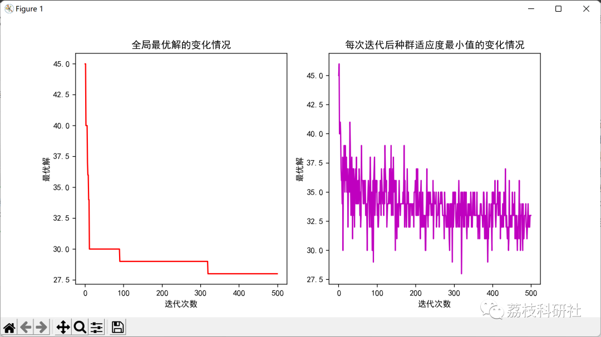

# Flexible workshop scheduling problem based on improved particle swarm and differential optimization algorithm (Python code implementation)

💥💥💥💞💞💞 Welcome to this blog❤️❤️❤️ 💥💥💥
🏆 Bloggers' Advantages: 🌞🌞🌞 The content of the blog strives for rigorous thinking and clear logic to facilitate readers.
⛳️ Mantra: A journey of a thousand miles is begun with a single step.
Litchi Research Society
Code Collection: Power Systems, Intelligent Algorithms and Applications, Neural Network Prediction, Path Planning, Optimized Scheduling, Workshop Scheduling, Image Processing, Signal Processing, etc.  
🎁 Special Section Links:  
🌈🌈🌈🌟🌟🌟 Electrical Code Intelligent Algorithms and Their Applications Path Planning Neural Network Prediction Optimized Scheduling Image Processing Workshop Scheduling Signal Processing Romantic Her Thoughts Math Modeling Complete Code Issues  
Directory  
💥1 Overview  
📚2 Run Results  
🎉3 References  
🌈4 Python Code Implementation  
💥1 Overview  
For the flexible job-shop scheduling problem (FJSP), which aims to minimize the maximum completion time, an improved particle swarm optimization algorithm is employed for solution. In selecting the mutation operator, by incorporating a roulette wheel strategy, the diversity of the population is enhanced, improving the global optimization capability of the algorithm. Comparative experiments with traditional particle swarm methods show that the improved particle swarm algorithm outperforms traditional methods in both global optimization speed and finding the minimum solution.  
📚2 Run Results  
🎉3 References  
[1] Yang Wenli, Li Changyun. Application of Improved Particle Swarm Optimization in Flexible Job-Shop Scheduling [J]. Science and Technology Innovation, 2021(12):5-6  
[2] Chen Qiang, Wang Yujia, Lin Weixing, Chen Wanfen. Improved Particle Swarm Optimization for Distributed Flexible Shop Scheduling Problem [J]. Electronic Technology, 2021, 34(10):63-68  
🌈4 Python Code Implementation  
Click the article's lower left corner to read more.

## Images

<!-- PAYMENT_BLOCK -->

## Get this dataset

- Payment link (Stripe): [Buy now](https://buy.stripe.com/3cs8yP7sY87d0vu9AB)
- Payment QR code: 

<!-- /PAYMENT_BLOCK -->
